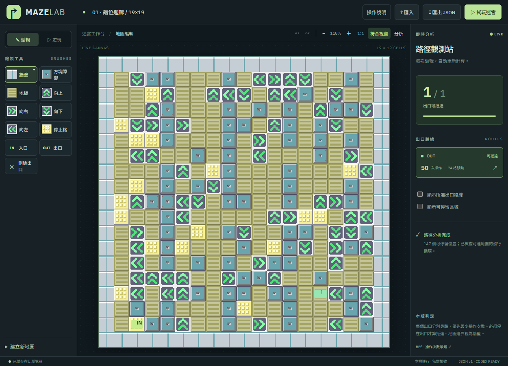
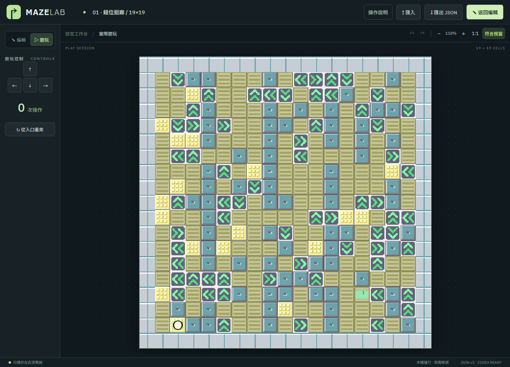
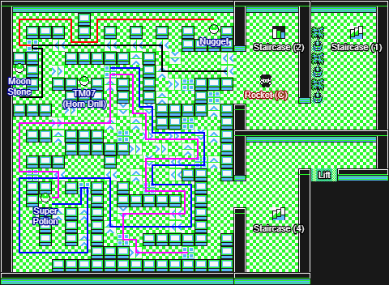

# Maze Lab · 迷宮設計實驗室

純前端迷宮編輯／試玩工具。使用者用畫面編輯與試玩，Codex 用 JSON 和共用引擎建圖、驗證。支援箭頭滑行、停止格、障礙、即時尋路、復原／重做及本機自動儲存。

**想直接玩：** [19 × 19 挑戰關卡（10 關）](data/challenge-19x19/README.md)，透過「匯入」選取 `data/challenge-19x19/level-01.json` 等檔案，再按「試玩迷宮」。沒有教學順序，任選一關開始。

**下次回來：啟動專案 → 按「匯入」選 `data/` 中的 JSON → 編輯或試玩 → 匯出 JSON 存回 `data/`。**

[啟動](#1-啟動專案) · [匯入與存檔](#2-匯入地圖與保存修改) · [編輯](#3-編輯地圖) · [試玩](#4-試玩迷宮) · [疑難排解](#7-常見問題) · [Codex 接續手冊](docs/CODEX_OPERATIONS.md)

## 1. 啟動專案

需要 Node.js 22 與 npm。在專案根目錄開啟終端：

```powershell
cd C:\work\maze-maker\maze-maker
npm install
npm run dev
```

第一次或套件有變更時執行 `npm install`；平常只需 `npm run dev`。

開啟終端顯示的網址，通常是 **http://127.0.0.1:5173/**。若埠被占用，Vite 可能使用其他埠，以當次輸出為準。開發期間保持終端運作，結束時按 `Ctrl+C`。不需後端服務、帳號或資料庫安裝。

## 2. 匯入地圖與保存修改

1. 按右上角 **「↥ 匯入」**。
2. 選取專案中的 [`data/rocket-hideout.json`](data/rocket-hideout.json)。
3. 確認取代目前地圖，即可編輯、求解或試玩；誤匯入可在當次工作階段使用復原。
4. 完成修改後按 **「↧ 匯出 JSON」**，瀏覽器會下載 `maze.json`。
5. 將下載檔命名後存進 `data/`，例如 `data/rocket-hideout-v2.json`；需要更新原檔時再明確覆蓋它。

> **自動儲存不會改寫 `data/` 裡的檔案。** 它只儲存在目前瀏覽器的 IndexedDB。匯入也是讀取一份副本，後續修改須匯出才能回存為專案檔案。

| 保存方式 | 存放位置 | 何時使用 |
| --- | --- | --- |
| 自動儲存 | 目前瀏覽器、目前網站來源 | 重新整理後繼續編輯 |
| 匯出 JSON | 瀏覽器下載位置，再自行移至 `data/` | 長期保存、版本管理、交給 Codex 或其他人 |
| `data/*.json` | 專案資料夾，可納入 Git | 作為下次匯入的地圖檔 |

開啟網頁時會優先載入瀏覽器已儲存的地圖；沒有存檔才顯示空白圖。`data/` 是檔案存放區，不會自動出現在網頁清單，也不會自動覆蓋瀏覽器存檔。

## 3. 編輯地圖



*圖示使用 19 × 19 挑戰第一關與使用者指定的像素素材，為避免劇透已關閉路線顯示。*

| 畫面位置 | 用途 |
| --- | --- |
| 頁首 | 修改地圖名稱、匯入、匯出、切換試玩 |
| 左側工具 | 選筆刷後在中央點選或拖曳繪製 |
| 中央工具列 | 復原／重做、縮小／放大、1:1、符合視窗、分析欄開關 |
| 中央畫布 | 編輯地圖；捲軸或觸控板平移查看 |
| 右側分析 | 編輯時選出口查看路線；按中央工具列「分析」可收合。試玩時隱藏 |
| 底部狀態列 | 確認是否已儲存在瀏覽器，或是否儲存失敗 |

### 筆刷怎麼用

| 工具 | 效果 |
| --- | --- |
| 牆壁／方塊障礙 | 都會阻擋步行與滑行，外觀不同 |
| 地板 | 清除該格的牆、障礙或機關 |
| ↑ → ↓ ← | 設定強制滑行方向 |
| 停止格 | 角色滑到這一格時停止 |
| 入口 | 移動唯一的 In 起點 |
| 出口 | 新增 Out，可放多個出口 |
| 刪除出口 | 點選要移除的出口 |

放置入口／出口會先將該格改成普通地板，之後可再畫上箭頭或停止格。入口／出口所在格不能直接畫牆或障礙，須先移走入口或刪除出口。

左下角的寬高欄位是**建立新空白地圖的尺寸**，不是目前地圖尺寸，也不是調整現有地圖大小。設定後按「建立空白地圖」會取代目前地圖；尺寸範圍為 5–100。當前尺寸顯示在畫布上方，例如 `30 × 22 CELLS`。

### 快捷鍵與路線

| 操作 | 按鍵／顯示 |
| --- | --- |
| 復原 | `Ctrl+Z`；macOS 用 `Cmd+Z` |
| 重做 | `Ctrl+Shift+Z`；macOS 用 `Cmd+Shift+Z` |
| 連續繪製 | 按住滑鼠拖曳，每段拖曳算一次歷史操作 |
| 自由步行路線 | 實線 |
| 強制滑行路線 | 虛線；自主踩進第一個箭頭的那一步仍屬自由步行 |

右側每個出口各自求解；操作次數是一個方向命令的次數，一次命令可能滑過很多格。可停留區域表示能停下的位置，不包含所有滑行經過的位置。

「地點與道具標記」及「待核對格」只在匯入的 JSON 有對應資料時出現。文字遮住機關時，可先關閉地點標記。

## 4. 試玩迷宮



1. 按右上角 **「▷ 試玩迷宮」**，角色會從 In 開始。
2. 用 **方向鍵、WASD** 或左側畫面方向鍵移動。
3. 踩上箭頭後會自動滑行，途中等待滑行完成再操作。
4. 停在任一出口即顯示抵達提示，也可以繼續探索其他出口。
5. 想重來，按 **「從入口重來」**；想改地圖或看答案，按 **「返回編輯」**。

試玩時隱藏求解路線與整個右側分析欄，讓畫布使用更多空間。操作規則集中在右上角「操作說明」。若陷入滑行循環，需按「從入口重來」。試玩移動不會修改地圖。

### 移動規則

- 普通地板可以自由四向移動。
- 踩進箭頭後沿箭頭強制滑行；滑過普通地板會繼續前進，遇到其他箭頭會轉向。
- **踩停止格在該格停止；撞牆、藍框障礙或邊界時，停在最後可站立格。**
- 停下後可自由選方向，即使停在箭頭格，也不會原地重新觸發。
- 滑行循環按「座標＋方向」偵測，求解器會排除循環操作。

目前採用「每個 Out 獨立求解、停在 Out 才成功、BFS 求最少操作次數」。這些是本版的設計選擇，不代表已確認為遊戲原版的全部規則。

## 5. 火箭隊復刻目前進度

地圖檔：[`data/rocket-hideout.json`](data/rocket-hideout.json) · 原圖：[`public/reference/rocket-hideout.png`](public/reference/rocket-hideout.png)

<details>
<summary>查看來源圖（僅供獨立對照）</summary>



</details>

- 原圖 480 × 352，格線 16px，地圖 30 × 22。
- 地圖布局由 JSON 重建，來源圖不鋪在地圖上。外觀使用使用者後來指定的像素素材 `public/assets/rocket-hideout-frlg.png`，由 `src/tileArtwork.ts` 定義圖塊座標；原 480 × 352 復刻參考圖仍僅用於對照，彩色／黑色路線是註記。
- **仍有 22 個被文字遮住的格子待核對**，記錄於 JSON 的 `review`，不能宣稱完全還原。
- 隨附 JSON 暫設樓梯 (4) 為 In，樓梯 (1)、樓梯 (2)、電梯為 Out；可自行重新指定。
- 人物、道具、樓梯目前只是標記；沒有 NPC 事件碰撞、道具收集、跨樓層或電梯事件。
- 三個出口可解只證明目前配置能通行，不代表左側滑行迷宮已逐格驗收。

下一步仍是核對布局並實際試玩；批量生成與遊戲性評分尚未實作。

## 6. 檔案位置與開發命令

```text
maze-maker/
├─ data/                     地圖 JSON，從網頁匯入
│  └─ rocket-hideout.json    火箭隊復刻草稿
├─ docs/
│  ├─ CODEX_OPERATIONS.md   Codex 接續手冊、完整格式與工具操作
│  └─ images/               本 README 的實際畫面截圖
├─ public/reference/        獨立參考原圖
├─ src/
│  ├─ App.tsx               編輯器與試玩介面
│  ├─ engine.ts             共用移動、求解與 JSON 驗證引擎
│  ├─ storage.ts            瀏覽器自動儲存
│  └─ rocketHideout.ts      CLI／測試讀取復刻 JSON 的薄封裝
├─ scripts/                 命令列分析與輸出
├─ tests/                   規則與復刻資料測試
├─ examples/                小型引擎範例
└─ AGENTS.md                Codex 接續入口
```

| 命令 | 用途 |
| --- | --- |
| `npm run dev` | 啟動本機開發網站 |
| `npm test` | 驗證移動、碰撞、循環與路線重播 |
| `npm run build` | TypeScript 檢查並產生 `dist/` |
| `npm run --silent analyze -- data/rocket-hideout.json` | 分析地圖並輸出 JSON |
| `npm run --silent analyze -- examples/arrow-corridor.json` | 分析小型連鎖滑行範例 |
| `npm run --silent reference` | 將復刻 JSON 輸出至 stdout，不自動存檔 |

分析命令的無解出口仍會正常輸出 JSON，須檢查 `routes[].reachable`，不能只看程序是否成功。使用 `--silent` 可避免 npm 命令橫幅混入 JSON。

地圖 JSON 的必要欄位為 `version: 1`、`name`、`width`、`height`、`tiles`、`entrance`、`exits`。座標從左上 `(0,0)` 起算，格子索引為 `y * width + x`。完整欄位、引擎 API 及分析結果見 [Codex 操作手冊](docs/CODEX_OPERATIONS.md)。

## 7. 常見問題

| 問題 | 處理方式 |
| --- | --- |
| 網頁打不開 | 確認 `npm run dev` 仍在執行，開啟當次終端顯示的網址 |
| 第一次看到空白地圖 | 按「匯入」，選 `data/rocket-hideout.json` |
| 改了 JSON，網頁還是舊圖 | 瀏覽器存檔優先；重新匯入該 JSON。先匯出想保留的畫面修改 |
| 匯出後 `data` 沒變 | 下載通常在瀏覽器下載資料夾，需自行命名並移回 `data/` |
| 換瀏覽器／網址後存檔不見 | IndexedDB 依瀏覽器與網站來源分開；從 JSON 重新匯入。`localhost`、`127.0.0.1` 或不同埠可能使用不同存檔 |
| 原本標記的地方畫不了牆 | 先移走入口或刪除出口，再畫障礙 |
| 試玩中不能移動 | 先點地圖讓文字欄位失焦；等待滑行結束。若顯示循環，按「從入口重來」 |
| 圖太大或看不全 | 按「符合視窗」自動完整顯示，視窗變更也會調整；手動放大後可捲動平移 |
| 左下尺寸與地圖不同 | 那是「建立空白地圖」的輸入值；現有尺寸在畫布上方 |
| 儲存失敗 | 先匯出 JSON 保留進度，再排查瀏覽器儲存設定 |
| Git 沒列出 `node_modules`、`dist` 或 `.idea` | 已刻意忽略；`data/`、文件截圖與 `package-lock.json` 應可納入版本管理 |
| Codex 說瀏覽器不可用 | 查看 [瀏覽器恢復紀錄](docs/CODEX_OPERATIONS.md)：先找既有 CLI，啟動與後續操作須使用相同權限環境 |

## 8. 給下一次接手的 Codex

先讀 [AGENTS.md](AGENTS.md) 與 [操作手冊](docs/CODEX_OPERATIONS.md)，再看工作樹及使用者最新指示。

- 地圖統一存 `data/`，透過通用「匯入」載入；不要加回復刻專用面板或裝飾性底部標語。
- 批量操作直接使用 JSON 與 `src/engine.ts`；瀏覽器用於介面確認與試玩。
- 不要清除使用者 IndexedDB，不要覆蓋既有地圖修改，也不要刪除 `.idea`／`.iml` 本機檔案。
- 修改規則後跑測試，交付程式變更前編譯；更新入口或行為時同步更新文件。
- 更新截圖先存 `output/playwright/`；選定供文件使用的圖片再放 `docs/images/`，避免被 `.gitignore` 排除。
